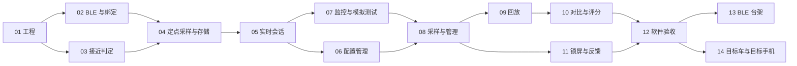

# BYD Proximity Lab V1 实施索引

## Notes

- 以 [V1 规格](spec.md) 为验收依据。[Android 技术基线](android-toolchain.md) 是版本矩阵和构建约束的唯一来源，[原始需求基线](requirements-baseline.md) 提供背景和场景，[领域词汇](../../GLOSSARY.md) 统一术语。票据示例数值仅用于测试。
- 开发从初始状态重开，01–12 均待执行。01 首先验证实际编译链和依赖解析。旧 APK 和旧测试记录不能作为本轮证据。
- 先检查当前分支和工作树。实现代码使用独立非基线分支或已分配的 worktree。领取满足依赖的票据，按项目追踪器约定记录 `claimed`、执行证据和 `resolved`。完成时在票据 `## Answer` 记录实际运行的命令及结果、公开接口与下游入口、仍需实测的项目。
- `Blocked by` 指实现前置条件。下表状态以各票据为准。01–12 为 Agent 实施和软件验证票，13–14 需可操作的手机及现场设备。软件验证通过后可安排两类现场验收。设备不可用时登记具体缺项，验收结果保持待测。

## 依赖图

### 实现时找哪张票

- **谁可以触发**看 [03 判定用例](issues/03-proximity-engine.md#判定用例)，谁可以发出反馈看 [05 会话模式](issues/05-live-session.md#会话模式) 和 [11 反馈记录](issues/11-lock-screen-test.md#反馈记录)。
- **为什么实时与回放应一致**看 [04 保存时间线](issues/04-local-storage.md#存储约定) 和 [09 回放样例](issues/09-replay-engine.md#回放样例)。
- **如何给一次试验评分**看 [10 评分判定表](issues/10-comparison-scoring.md#评分判定表)。模拟事件是否产生与锁屏是否显示通知在 [12 软件验收](issues/12-software-verification.md#验收矩阵) 和现场票分别记录。

## 票据清单

| 票据 | 工作 | 依赖 | 执行方 |
| --- | --- | --- | --- |
| [01](issues/01-android-bootstrap.md) | Android 工具链验证、构建规范与四个页面入口 | 无 | Agent |
| [02](issues/02-ble-target.md) | BLE 发现、人工绑定与目标关联 | 01 | Agent |
| [03](issues/03-proximity-engine.md) | 共享接近判定与事件规则 | 01 | Agent |
| [04](issues/04-local-storage.md) | 定点采样、Room Session 存储与会话生命周期 | 02、03 | Agent |
| [05](issues/05-live-session.md) | 前台模拟测试、配置快照与模拟事件入库 | 04 | Agent |
| [06](issues/06-algorithm-config-ui.md) | 算法配置管理及下次测试生效 | 05 | Agent |
| [07](issues/07-live-monitor-ui.md) | 实时监控、图表和模拟事件历史 | 05 | Agent |
| [08](issues/08-sampling-session-ui.md) | 行走采样、人工标记与完整 Session 管理 | 06、07 | Agent |
| [09](issues/09-replay-engine.md) | 从 Session 详情重现原配置回放 | 08 | Agent |
| [10](issues/10-comparison-scoring.md) | 算法对比、人工标记评分与界面 | 09 | Agent |
| [11](issues/11-lock-screen-test.md) | 锁屏采集、通知与中断恢复 | 08 | Agent |
| [12](issues/12-software-verification.md) | 软件端到端验证与现场交接 | 10、11 | Agent |
| [13](issues/13-controlled-ble-acceptance.md) | 可控 BLE 实验工具验收 | 12 | 人工现场 |
| [14](issues/14-target-vehicle-acceptance.md) | 目标车与目标手机实测验收 | 12 | 人工现场 |

## 验收覆盖

| 行为 | 票内自动化验收 | 现场或集成证据 |
| --- | --- | --- |
| RSSI 滤波、重复、越界、尖峰及持续确认 | [03](issues/03-proximity-engine.md#判定用例) P1–P9 | 12 复用夹具 |
| 双阈值、首个 FAR → NEAR 一次、NEAR 停留和折返 | 03 共享入口，05 前台真实调用 | 12 集成，13 可控设备，14 目标车 |
| 样本过期、冷启动、中断恢复、身份不确定与改绑 | 02 目标入口，03 事件，05 新测试，11 后台接合 | 13 切蓝牙，14 车况和相邻车辆 |
| 原始时间线、同一时刻顺序、Session 中断与重开、记录增量 | 04 真 Room 和生命周期，08 标记、删改及升级 | 12 走安装和采集入口 |
| 配置快照隔离、UI 刷新不改采集 | 06 运行中改配，07 限频与完整记录对照 | 12 查运行和已保存记录 |
| 同输入同版本实时与回放一致、不同配置对比与评分 | 09 以真实存储和共享判定比较，10 固定时点评分 | 12 全链路，13/14 带标记试验 |
| 只读权限、通知禁止和前台服务恢复 | 01 Manifest 检查，02 权限，11 接合行为 | 12 Android 版本差异，13/14 实际锁屏 |

## Decisions-so-far

- 实时与回放共用接近判定入口。每次模拟测试从 `UNKNOWN` 开始，在有效观测期间确认 `FAR → NEAR` 后触发一次。中断、过期或身份失去确认时撤销触发资格。
- 依赖关系让 BLE 采集与纯 Kotlin 判定可分别完成，再汇合到定点采样和前台模拟测试。04 建立唯一 Room 存储和会话生命周期，05、06、08、09 按各自切片增加实际使用的记录。08 等待 06 的 schema 增量和 07 的图表。07、08、10 复用同一图表契约。
- 把软件验证、可控 BLE 验收与目标车验收分别记录。算法夹具能证明事件契约，锁车休眠和锁屏通知需现场证据。
- `BLUETOOTH_SCAN` 使用 `neverForLocation`，实际目标广播过滤表现由 13/14 记录。
- 票据 01 已完成：Android 工程基线固定并实际验证（Gradle 9.9.1、JDK 21、AGP 9.5.1、Kotlin/Compose Compiler 2.4.21、KSP 2.3.14；minSdk 31 / compileSdk 37 / targetSdk 36；四页导航与 Room KSP 探针）。验证：assembleDebug、testDebugUnitTest、lintDebug、connectedDebugAndroidTest（3/3）通过，APK 无 INTERNET。下游入口：MainActivity、ProximityLabApp、LabDestination 与各页 ViewModel。
- 票据 03：纯 Kotlin 共享接近判定 `ProximityEngine` 从 `UNKNOWN` 起按有序会话时间线只在确认 `FAR` 后触发一次 `ENTERED_RANGE`，停扫、过期、身份失去确认与改绑撤销触发资格，决策与事件携带算法/触发规则版本；验证：`:app:assembleDebug :app:testDebugUnitTest --rerun-tasks` 全量 37 tests 0 failures、聚焦 `--tests 'com.byd.proximitylab.proximity.*'` 32 tests 0 failures、`:app:lintDebug` 通过、aapt2 badging 为 minSdk 31 / targetSdk 36 / `BLUETOOTH_SCAN` neverForLocation / 无 INTERNET；下游：`com.byd.proximitylab.proximity.ProximityEngine` 的 observe/advanceTo/setScanAvailable/setTargetIdentity/rebindTarget，`ProximityTestHarness` 与 P1–P9 夹具供 05、09、12 复用。

- 票据 02 已完成：只读 BLE 扫描、单目标人工绑定与身份关联；身份冲突保留原绑定并输出 `UNCERTAIN`；绑定持久化统一到 `ProximityLabDatabase`；7 项复审阻塞关闭。验证：67 JVM tests、15 connected tests（1 skipped 真实广告者）、lint 0 errors；APK 仅 `BLUETOOTH_SCAN(neverForLocation)`。下游：`TargetObservationSource`、`TargetBindingStore`、`TargetAssociationPolicy`；04 复用同一 Room 数据库。
- 票据 04：定点采样到 Room Session 的首个闭环完成，Session 生命周期、稳定时间线顺序与覆盖终点由共用 `SessionRecorder`/`SessionStore` 提供，数据库 v2 与导出的 schema 支持后续升级。验证：`:app:testDebugUnitTest` 83 tests 0 failures，`:app:connectedDebugAndroidTest` 28 tests 0 failures（1 skipped 真实广告者），`:app:assembleDebug :app:lintDebug` 通过且 APK 无 INTERNET。下游：`SessionRecorder`、`SessionStore`、`SessionModels`、`RoomSessionStore`/`SamplingSessionDao`、`ProximityLabDatabase` v2，供 05、08、09、11 复用。
- 票据 05：实时监控与前台模拟测试由应用级 `LiveMonitorController` 统一驱动，测试从 `UNKNOWN` 起步，配置快照、时间线与原始事件写入 Room v3 并在持久化后提供反馈入口。验证：`:app:testDebugUnitTest` 98 tests、`:app:connectedDebugAndroidTest` 36 tests（1 skipped 真实广告者）均 0 failures，`:app:assembleDebug :app:lintDebug` 通过且 APK 无 INTERNET；独立复审在真实页面上复验「普通监控 FAR → 测试仅近端样本零事件」、唯一 FAR→NEAR 事件与原因、注入时钟过期、重开不补发及 2→3 迁移。下游：`AppContainer.liveMonitorController`、`SessionConfigSnapshot`（06）、`LiveReadingPoint`/`SimulationTestView`（07/08）、`SessionTimelineProximityRunner`（09）、`SimulationRunStore.updateEventFeedback`/`SimulatedEventFeedbackStatus`（11）。
- 票据 06：具名算法配置在 Room v4 中持久化，内置 Baseline/EMA 可复制与选择但不可改删，删除当前配置同事务回退默认；测试开始时由生效配置生成与配置行解耦的快照，运行中编辑只影响下一次测试。验证：`:app:testDebugUnitTest` 121 tests 0 failures、`:app:connectedDebugAndroidTest` 48 tests 0 failures（1 skipped 真实广告者）、`:app:assembleDebug :app:lintDebug` 通过且 lint 0 errors、APK 无 INTERNET。下游：`AlgorithmConfigStore`（observe/load/create/update/duplicate/delete/select/snapshot）、`AlgorithmConfig`/`BuiltInAlgorithmConfigs`、`AlgorithmConfigValidator`、`AppContainer.algorithmConfigStore`，供 10 复用配置选择。
- 票据 07：实时监控页展示真实判定、双阈值与时间窗可切换的只读曲线，并提供模拟事件历史；图表抽点不改 Room 原始记录，只读时间线输入可脱离实时扫描复用。验证：`:app:testDebugUnitTest` 143 tests 0 failures、`:app:connectedDebugAndroidTest` 54 tests 0 failures/1 skipped、`:app:assembleDebug :app:lintDebug` 通过且 APK 无 INTERNET（由实施与脚本 gate 执行，本记录轮未重跑）。下游：`MonitorViewModel`/`MonitorScreen`、`RssiChart`/`RssiChartBuilder`、`SessionChartInput.fromTimeline`、`SimulationEventHistoryReader.observeLatest`。
- 票据 08：定点与行走采样、人工参考标记、Session 详情/筛选/改名/标签/删除接到真实采集与 Room v5，评分只采用覆盖范围内标记且不改原始观测；验证：`:app:testDebugUnitTest` 166 tests、`:app:connectedDebugAndroidTest` 60 tests（1 skipped 既有真实广告者）均 0 failures，`:app:assembleDebug`/`:app:lintDebug` 通过且 APK 无 INTERNET（由实施与脚本 gate 执行，本记录轮未重跑）。下游：`SessionMarkerRecorder`、`SessionMarkerPolicy`、`SessionDetailBuilder`/`SessionDetailSnapshot.sessionId`（09 回放入口）、`SessionListFilter`、`SessionStore` 的改名/标签/标记读写（供 09、10 使用）。

## Fog

- [01](issues/01-android-bootstrap.md) 先实际验证选定版本的构建、KSP、依赖解析与 Lint。供应商文档的支持范围及已核验的 Android AAR 要求见 [Android 技术基线](android-toolchain.md)。
- 目标车地址变化后的唯一关联证据、休眠广播以及进入 `NEAR` 前能否观察到可信 `FAR` 由 14 实测。尚无可信特征时按 02 的身份不确定分支运行。
- 目标手机具体型号、ROM、触发时间窗、生产阈值、延迟和耗电指标待标定。13 与 14 记录数据和设备条件，无法评估的项目标为待测。
